# Zehunger Solutions ERP — Phase One Walkthrough Guide

**From an empty system to a delivered, fully traced sale.**
A step-by-step guide for presenting the Zehunger Solutions Circular Economy ERP, built from a complete live walkthrough recorded on 30 October 2026.

---

## How to use this guide

This guide follows one real batch of black soldier fly (BSF) larvae through the whole system, from the moment organic waste arrives at the farm to the moment a customer signs for dried larvae and frass fertiliser. Every screen, reference number and figure in it comes from that walkthrough.

- **Presenting live:** follow Steps 0 to 10 in order. Each step says who does it, where to click, what to type, what the system checks, and what to point out to the audience.
- **Presenting from slides:** the PowerPoint version follows the same steps, with speaker notes on every slide.
- **Training staff:** each step can be read on its own; the "What the system checks" boxes explain the rules a user will meet.

> **Tip:** Rehearse on the local demo or development system first. On the live site, Step 0 (set-up) must be done before any data can be entered.

---

## The chain at a glance

Organic waste becomes two products. The system tracks both, all the way to the customer.

| Stage | What happens | Reference created |
|---|---|---|
| 1. Waste in | Organic waste is collected, weighed and checked | Waste lot `WL-` |
| 2. Substrate | Clean waste is prepared into larvae feed | Substrate batch `SUB-` |
| 3. Production | Larvae are reared on the substrate in bio-pods | Production batch `BSF-` |
| 4. Rearing | Feeding, monitoring and health are recorded | Events `EVT-` |
| 5. Harvest | Larvae are harvested; frass is sieved off | Harvest `HRV-`, frass lot `FRS-` |
| 6. Drying | Wet larvae are dried and weighed | Drying batch `DRY-` |
| 7. Curing | Frass is cured into fertiliser | (on the frass lot) |
| 8. Quality | Each product is checked, approved and released | Checks `QCK-`/`FQC-`, approvals `QCA-`, product lots `LOT-` |
| 9. Sales | Orders, stock reservation, dispatch, delivery | Orders `ORD-`, deliveries `DEL-` |
| 10. Insight | Trace, dashboard, Batch 360 and reports | — |

**Key message for the audience:** every kilogram is linked to where it came from. A complaint about one bag of feed can be traced back to the market the waste came from, the batch that ate it and the officer who passed it.

---

## Who does what

The system gives each person only the screens and actions their job needs.

| Role | Example person | What they do in the walkthrough |
|---|---|---|
| Super admin (owner) | Zihanga Owner | Sets up farms, stores and accounts; sees everything: trace, dashboard, Batch 360, reports, money |
| Operator (farmer) | Peter | Records waste, substrate, batches, feeding, monitoring, health, harvest, drying and frass curing |
| QC officer | Daniel Otieno | Checks dried larvae and frass, approves or rejects, releases approved product into stock |
| Sales officer | Brian Mwangi | Adds customers, takes orders with prices, reserves stock, dispatches, confirms delivery |
| Viewer | — | Read-only access, for example for investors |

> **Note:** operators see only the farms, sites and facilities they are assigned to. Orders, customers and money are visible only to farm-level users.

---

## The example data used in this guide

| Record | Reference | Key figures |
|---|---|---|
| Waste lot | WL-2026-00001 | 150 kg vegetable waste, Kericho Municipal Market |
| Waste lot | WL-2026-00002 | 45 kg, quarantined (not clean enough to use) |
| Substrate batch | SUB-2026-00001 | 120 kg prepared from WL-2026-00001 |
| Production batch | BSF-2026-00001 | 100 kg substrate, bio-pod A01, harvest limit 40 kg |
| Harvests | HRV-2026-00001, HRV-2026-00002 | 36 kg + 3 kg wet larvae |
| Frass lots | FRS-2026-00001, FRS-2026-00002 | 52 kg + 8 kg separated; 45 kg + 7 kg cured |
| Drying batches | DRY-2026-00001, DRY-2026-00002 | 12 kg + 1 kg dried larvae (about 3:1) |
| Product lots | LOT-2026-00001 to LOT-2026-00004 | 13 kg dried larvae, 52 kg frass fertiliser |
| Customer order | ORD-2026-00001 | Mama Grace Agrovet: 10 kg larvae + 40 kg frass, KES 3,800 |
| Delivery | DEL-2026-00001 | 50 kg, received by Grace Chebet |

---

## Step 0 — Set up the farm and the team

**Who:** Super admin (owner) · **Where:** *More → Farm Setup* (`/setup`) and the admin portal

Before anyone can record work, the farm must exist in the system. Locations are arranged as a tree: **Organization → Farm → Site → Facility → Storage location / bio-pods**.

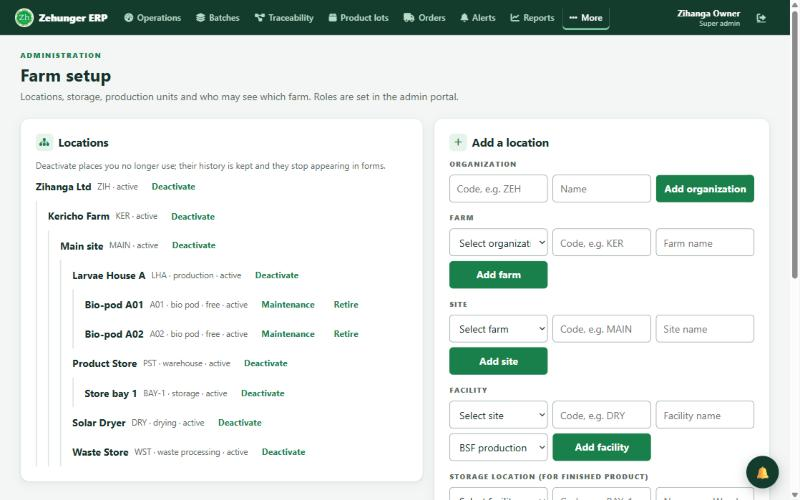

**Do this, in order:**

1. **Organization:** for example *Zihanga Ltd* (code `ZIH`).
2. **Farm:** *Kericho Farm* (code `KER`).
3. **Site:** *Main site* (code `MAIN`).
4. **Facilities** on that site, one per kind of work:
   - *Waste Store* (waste processing) — where waste arrives
   - *Larvae House A* (BSF production) — where larvae are reared
   - *Solar Dryer* (drying)
   - *Product Store* (warehouse)
5. **Storage location** in the Product Store: *Store bay 1* (`BAY-1`). Released product is received here.
6. **Bio-pods** in Larvae House A: *A01*, *A02*.
7. **Accounts** in the admin portal: one per person, with the right role (operator, QC officer, sales officer), and give each one access to Kericho Farm.

**What to point out:**
- Places can be **deactivated** but never deleted once used, so history is always kept.
- Self-registration is switched off: **only an administrator creates accounts.**

> **Live site note:** the live database was cleared for the presentation. It keeps the four user accounts but has no farm. Do Step 0 on the live site first (or present on the local demo), and give the operators access to the new farm.

---

## Before you start: signing in and getting around

**Who:** everyone · **Where:** the landing page (`/`) → *Enter Admin Portal* or *Enter Farmer Portal*

- The **landing page** offers the Admin Portal (office and management) and the Farmer Portal (phone-friendly daily work). The presentation guides are also downloadable from here.
- After signing in, each role lands on its own start page: the owner on the **admin portal**, operators on the **Farmer Portal** (their batches and daily tasks), QC and sales officers on the **Operations dashboard**.
- The **top bar** links the main areas: Operations, Batches, Traceability, Product lots, Orders, Alerts, Reports and More.
- **Data entry** (`/dashboard`) has a sidebar of sections: Waste Management, Larval Production, Drying Process, Frass & Fertiliser, Facility, Hatchery and Records.

**How the data-entry forms behave (worth showing once):**
- Each section shows **one form at a time**. Use the arrows or the dots at the bottom to move between forms.
- Dates default to **today** and times to **now**; future dates are refused.
- Name fields default to the **signed-in person**; each form remembers the last farm, site and facility used.
- Problems are shown **under the field as you type**, and the form will not save until they are fixed.
- After saving, a green confirmation appears **at the bottom of the screen and under the button**, with the new reference number.
- Each form lists its **last 5 entries** underneath, so the user can see their work was recorded.

---

## Step 1 — Record the waste coming in

**Who:** Operator · **Where:** *Data entry → Waste Management → Waste Sourcing*

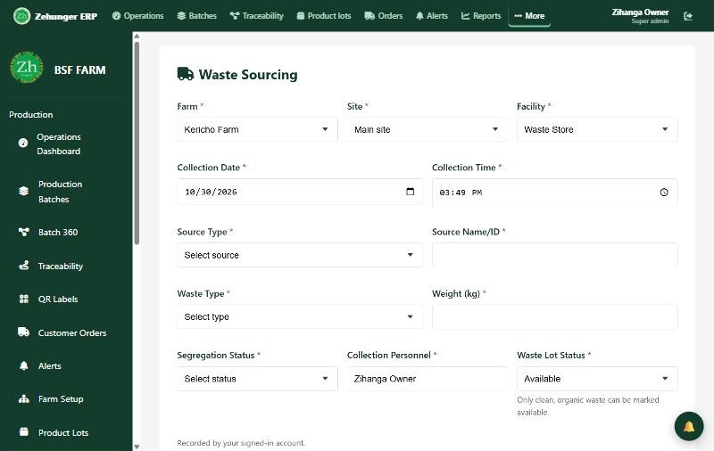

**Fill in:**

| Field | Example |
|---|---|
| Farm / Site / Facility | Kericho Farm / Main site / Waste Store |
| Collection date and time | today, now (filled in) |
| Source type and name | Market — *Kericho Municipal Market* (also: restaurant, brewery, food industry, household, farm) |
| Waste type | Vegetable |
| Weight (kg) | 150 |
| Segregation status | Organic |
| Collection personnel | filled in with the signed-in name |
| Waste lot status | Available |

**Result:** ✓ *WL-2026-00001* — 150 kg available for substrate.

**A second lot to show the quality gate:** record 45 kg that arrived mixed with plastic, and set it to **Quarantined**. It becomes *WL-2026-00002* and will **not** appear when preparing substrate.

**What the system checks:**
- Only clean, organic waste can be marked *Available*.
- Weights must be positive; dates cannot be in the future.
- The other Waste Management forms (Storage Records, Processing Records, Waste Monitoring) log what happens to waste while it waits.

---

## Step 2 — Prepare the substrate

**Who:** Operator · **Where:** *Data entry → Larval Production → Substrate Preparation*

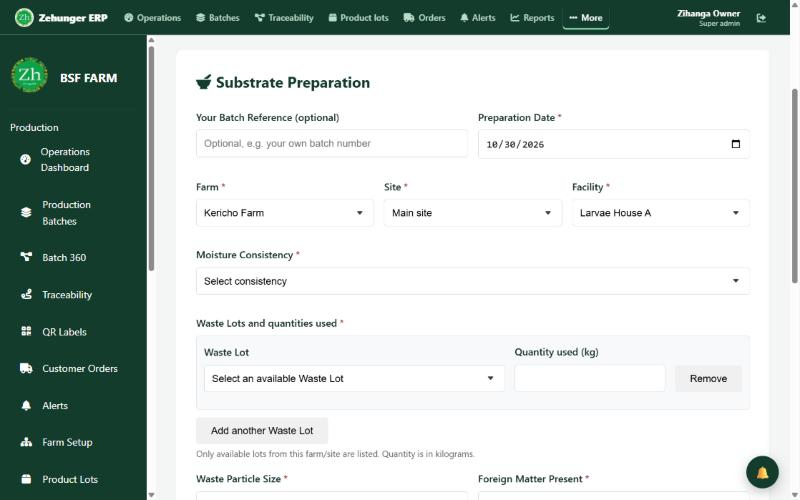

**Fill in:** preparation date, Kericho Farm / Main site / Larvae House A, moisture consistency, then **Waste lots and quantities used**: pick *WL-2026-00001* and enter **120 kg**. Add particle size and whether foreign matter was found.

**Result:** ✓ *SUB-2026-00001* — 120 kg of substrate. WL-2026-00001 now shows **30 kg left**.

**What the system checks:**
- Only **available** waste lots on the same farm are offered (the quarantined lot is not).
- You cannot use more kilograms than the lot has left.
- Several waste lots can go into one substrate batch; each link is stored for traceability.

---

## Step 3 — Start a production batch

**Who:** Operator · **Where:** *Batches → Production batch record → New batch* (`/production_batch.html`)

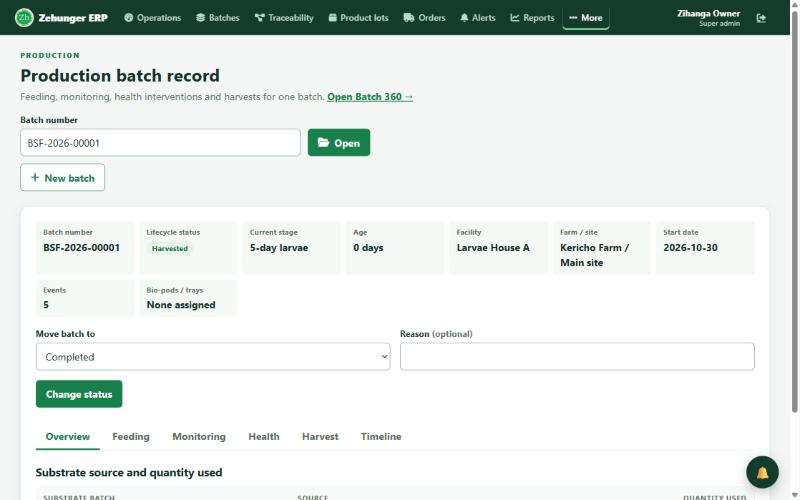

**Fill in:** facility *Larvae House A*, start date, expected harvest date, bio-pod *A01*, substrate *SUB-2026-00001* with **100 kg** issued, and a **harvest limit of 40 kg**.

**Result:** ✓ *BSF-2026-00001*, status *Planned*. SUB-2026-00001 now has 20 kg left.

**Moving the batch through its life** (the *Move batch to* control on the same page):

> Planned → Active → Monitoring → Ready for harvest → Harvested → Completed
> (Paused and Health alert are available when needed.)

**What the system checks:**
- The harvest limit caps how much can ever be harvested from the batch.
- A batch must be *Ready for harvest* before a harvest can be recorded.
- Every status change is kept in the batch history with who did it and why.

---

## Step 4 — Record daily rearing

**Who:** Operator · **Where:** *Data entry → Larval Production* (Feeding Schedule, Environmental Monitoring, Health & Intervention)

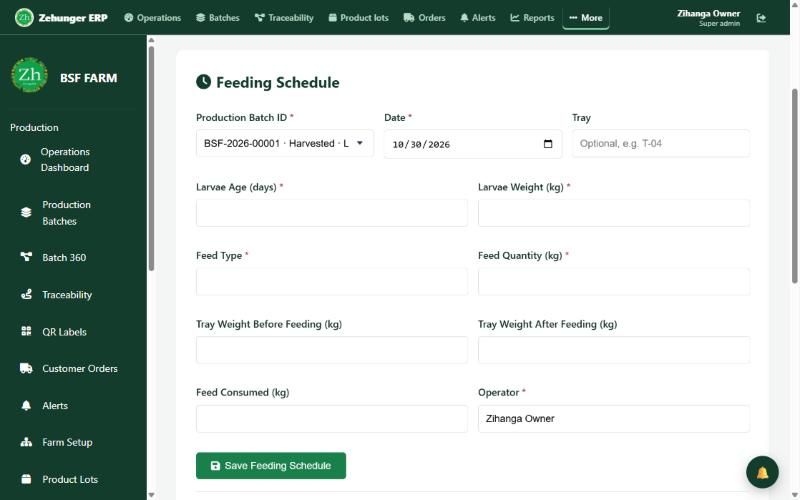

| Form | What to enter | Example result |
|---|---|---|
| Feeding Schedule | batch, larvae age, larvae weight (kg), feed type, feed quantity (kg), consumed (kg), tray | EVT-000001 |
| Environmental Monitoring | temperature (°C), humidity (%), ammonia | EVT-000002 |
| Health & Intervention | issue seen, severity, action taken, follow-up | EVT-000003 |

**What to point out:**
- The **Production Batch** field is a picker of real batches, so events always attach to the right batch.
- Everything is entered **in kilograms**, one unit for every weight.
- Open health issues, harvests that are due or overdue, QC waiting or failed, low or quarantined stock and late orders raise **alerts** (bell icon, top right) for the people responsible.

---

## Step 5 — Harvest the larvae and separate the frass

**Who:** Operator · **Where:** *Data entry → Larval Production → Harvest & Yield* (or the batch record)

First move BSF-2026-00001 to **Ready for harvest**.

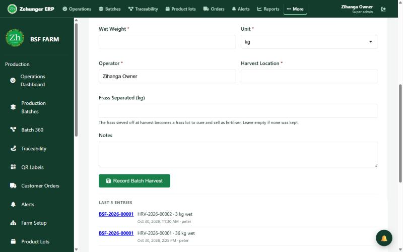

**Fill in:** batch *BSF-2026-00001*, harvest date and time, **wet weight 36 kg**, stage *prepupae*, operator, harvest location, and **Frass Separated: 52 kg**.

**Result:**
- ✓ *HRV-2026-00001* — 36 kg wet larvae.
- ✓ *FRS-2026-00001* — 52 kg frass, automatically started **curing**.

A second pick from the same batch (3 kg larvae, 8 kg frass) created *HRV-2026-00002* and *FRS-2026-00002*. The batch was then moved to **Harvested**.

**What the system checks:**
- Total harvest can never exceed the batch's harvest limit (40 kg here; 39 kg used).
- Frass is the harvest's **second product**: it is not waste, it becomes fertiliser for sale.

---

## Step 6 — Dry the larvae

**Who:** Operator · **Where:** *Data entry → Drying Process*

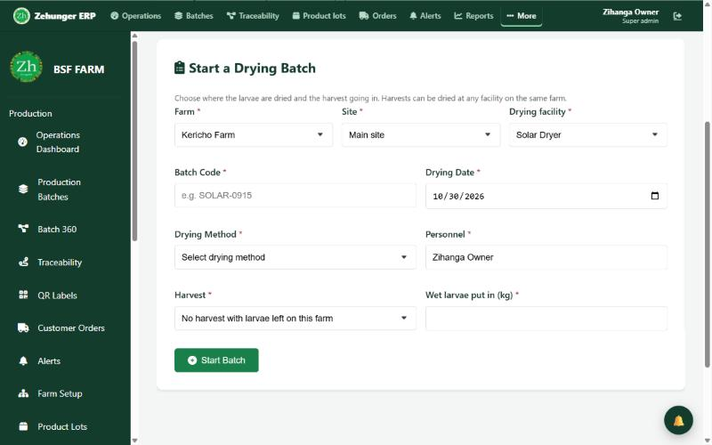

**The drying forms, in order:**

1. **Start a Drying Batch:** farm and site, drying facility *Solar Dryer*, batch code, method (*Sand drying, Sun drying, Solar dryer, Drum dryer, Roasting*), personnel, harvest *HRV-2026-00001* and **36 kg** of wet larvae in.
2. **Add a Harvest to a Drying Batch:** only while drying has not started.
3. **Move a Drying Batch to its Next Stage:** Draft → Received → Drying → Waiting for QC.
4. **Record Dried Output:** weigh what comes off the dryer — **12 kg at 8% moisture**.

**Result:** ✓ *DRY-2026-00001*: 36 kg wet in, 12 kg dry out (**3:1, 33.3% yield**), now *Waiting for QC*.

**What to point out:**
- The guideline box at the top of the section shows the expected ratios (for example 3:1 wet to dry).
- A drying batch can take harvests from several production batches; traceability keeps every link.

---

## Step 7 — Cure the frass

**Who:** Operator · **Where:** *Data entry → Frass & Fertiliser*

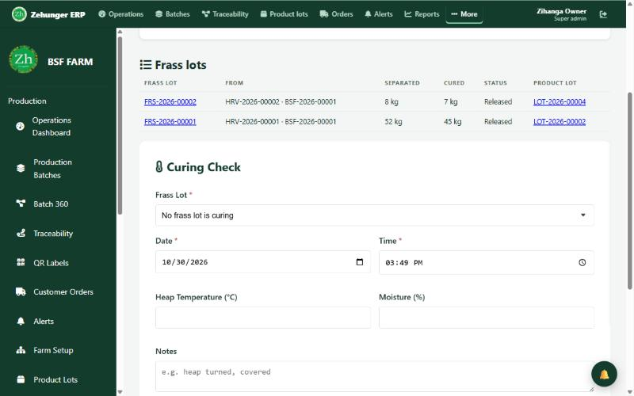

The **Frass lots** table at the top shows every lot and where it is: *Curing → Waiting for QC → Approved → Released*.

1. **Curing Check:** while the heap cures, record heap temperature and moisture (for example 45 °C, 32%). At least one check is required.
2. **Finish Curing:** enter the **cured weight** (52 kg became **45 kg**) and the date.

**Result:** FRS-2026-00001 is cured and **waiting for a quality check**.

**What the system checks:**
- Curing cannot be finished without at least one curing check.
- The cured weight cannot be more than the frass separated.

---

## Step 8 — Quality control and release

**Who:** QC officer (Daniel) · **Where:** *Drying Process* (forms 6–8) and *Frass & Fertiliser* (forms 3–5)

Each step is its own short form with its own Save button: **check → decide → release.**

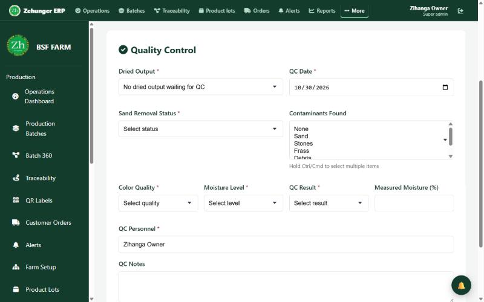

### Dried larvae

| Form | What Daniel enters | Result |
|---|---|---|
| **Quality Control** | the dried output; sand removal (*Complete*); contaminants (*None*); colour (*Good*); moisture level (*Dry*); measured moisture **8%**; result **Passed** | QCK-2026-00001 |
| **QC Decision** | the check; decision **Approved**; comments | QCA-2026-00001 — the drying batch completes |
| **Release Product Lot** | the approved output; product type *Dried larvae*; store (filled in: *Store bay 1*) | **LOT-2026-00001** — 12 kg in stock |

### Frass fertiliser

| Form | What Daniel enters | Result |
|---|---|---|
| **Frass Quality Check** | the frass lot; maturity **Mature** (dark, crumbly, earthy); moisture **30%**; no contaminants; result **Passed** | FQC-2026-00001 |
| **Frass QC Decision** | the check; **Approve for sale**; reason | FRS-2026-00001 approved |
| **Release Fertiliser to Stock** | the approved lot; store (filled in) | **LOT-2026-00002** — 45 kg frass fertiliser |

The second batch went through the same three forms: LOT-2026-00003 (1 kg dried larvae) and LOT-2026-00004 (7 kg frass fertiliser).

**What the system checks (strong points for the presentation):**
- **Nothing reaches stock without a passed check *and* an approval.** The database itself refuses any product lot without one.
- **Every output of a drying batch is settled** (approved or rejected) before the batch completes, so no output is ever left behind.
- Only the **latest** check on an output can be decided; an old check cannot be approved after a newer one failed.
- **Rejecting needs a reason.**
- *None* cannot be ticked together with a contaminant.
- Frass can pass **only when mature and clean**.
- Product type is a fixed choice, so released stock always matches what sales can order.
- The store list shows **only stores on the product's farm**, and picks it when there is just one.

---

## Step 9 — Sell and deliver

**Who:** Sales officer (Brian) · **Where:** *Orders* (`/orders`)

### 9.1 Add the customer

Click **New order**, then **New customer** beside the Customer label.

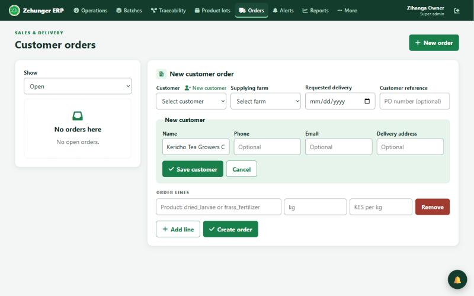

Enter the name (*Mama Grace Agrovet*), phone, email and delivery address (*Moi Highway, Kericho town*), then **Save customer**. The customer is created and picked for the order.

### 9.2 Create the order

| Field | Example |
|---|---|
| Supplying farm | Kericho Farm |
| Requested delivery | 3 Nov 2026 |
| Line 1 | `dried_larvae` — 10 kg at KES 220/kg |
| Line 2 | `frass_fertilizer` — 40 kg at KES 40/kg |

The product suggestions show **live free stock** (13 kg dried larvae, 52 kg frass). **Create order** → ✓ *ORD-2026-00001*, value **KES 3,800**.

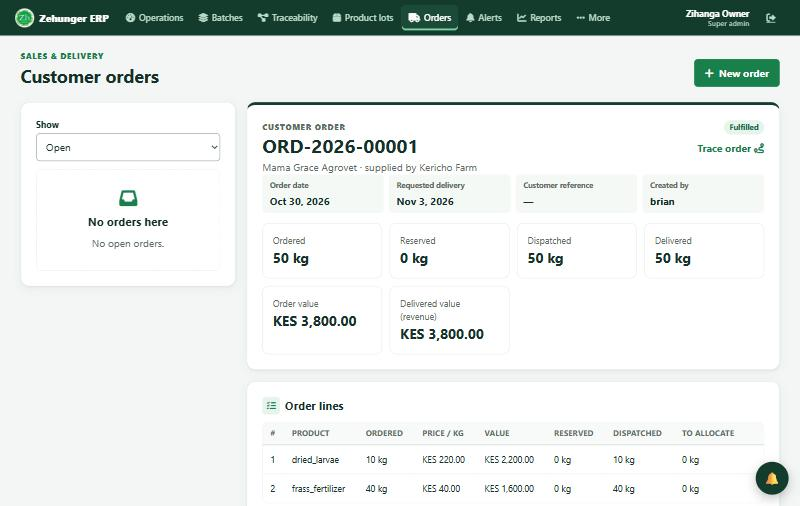

### 9.3 Reserve stock

On each line, **Allocate stock** lists free, QC-released lots on the farm, **oldest first**, with suggested amounts. Brian reserves 10 kg from LOT-2026-00001 and 40 kg from LOT-2026-00002. Reserved stock is held: no other order can take it.

### 9.4 Dispatch

The **Dispatch a delivery** form is filled in with the reserved amounts. Add the vehicle (*KDA 123B pickup*) and driver (*Joseph Kiprono*), then **Dispatch** → ✓ *DEL-2026-00001*. The 50 kg leaves Store bay 1 as recorded stock movements.

### 9.5 Confirm delivery

When the goods arrive, **Confirm delivered** and enter who received them (*Grace Chebet*). Delivered becomes 50 kg and **revenue becomes KES 3,800**.

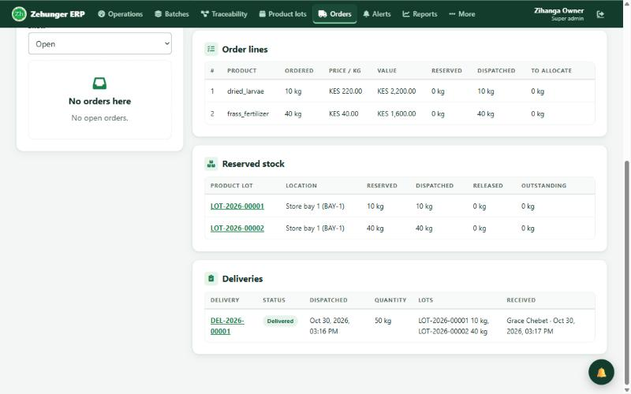

**What to point out:**
- Revenue is counted **only when the customer confirms receipt**: delivered kg × the agreed price.
- *Fulfilled* means everything ordered has been shipped; the delivery itself shows *Delivered*.
- **Cancel order** returns any reserved stock to inventory.

---

## Step 10 — The owner's view

**Who:** Super admin (owner) · **Where:** Traceability, Operations, Batch 360, Reports

### 10.1 Trace any record

*Traceability* → enter **DEL-2026-00001** → **Trace**.

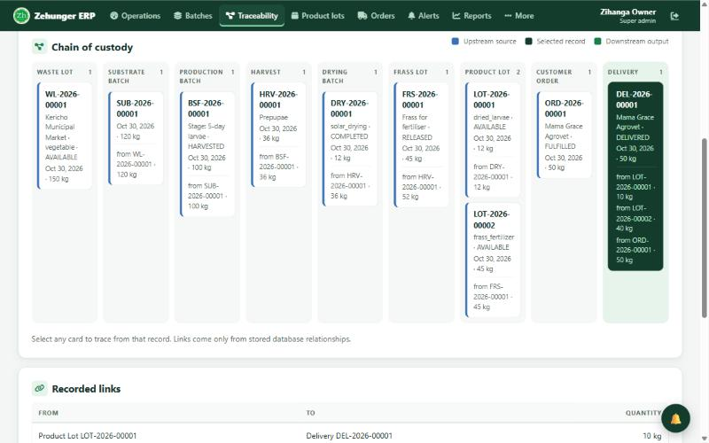

The delivery traces back through **9 upstream records**: both product lots, the drying batch and the frass lot, the harvest, the production batch, the substrate and the waste lot from *Kericho Municipal Market*. Every link is a stored record, never a guess. Click any card to trace from that record.

### 10.2 Operations dashboard

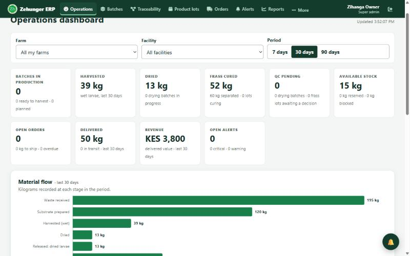

| Tile | Walkthrough value |
|---|---|
| Harvested | 39 kg wet larvae |
| Dried | 13 kg |
| Frass cured | 52 kg (60 kg separated) |
| QC pending | 0 |
| Available stock | 15 kg (3 kg larvae + 12 kg frass) |
| Delivered | 50 kg |
| Revenue | KES 3,800 |
| Open alerts | 0 |

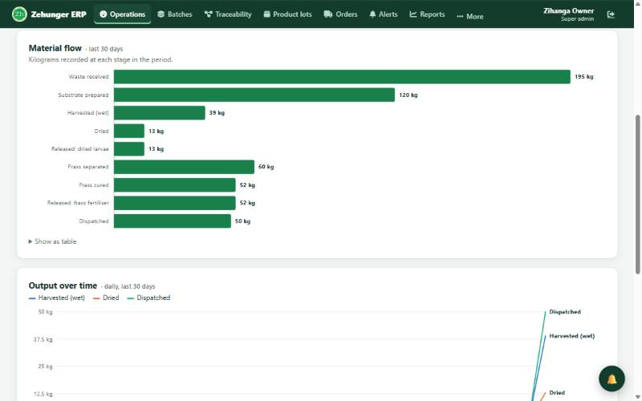

**Material flow** shows each stage in kilograms: waste 195 → substrate 120 → harvested 39 → dried 13 / released 13, and frass separated 60 → cured 52 → released 52 → dispatched 50. Filter by farm, facility and 7, 30 or 90 days.

### 10.3 Batch 360

*Batches → Batch 360* → **BSF-2026-00001**: one batch, end to end, on one page.

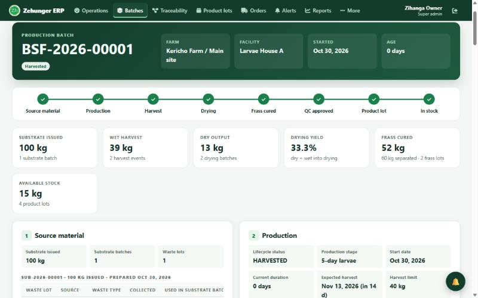

- The **lifecycle strip** shows each stage done: Source material, Production, Harvest, Drying, Frass cured, QC approved, Product lot, In stock.
- **Key figures:** 100 kg substrate, 39 kg harvest, 13 kg dry (33.3% yield), 52 kg frass cured, 15 kg in stock.
- Numbered cards cover source material, production, operations, harvest, processing, **frass & fertiliser**, quality, product, inventory, traceability (including customers) and a full audit trail.

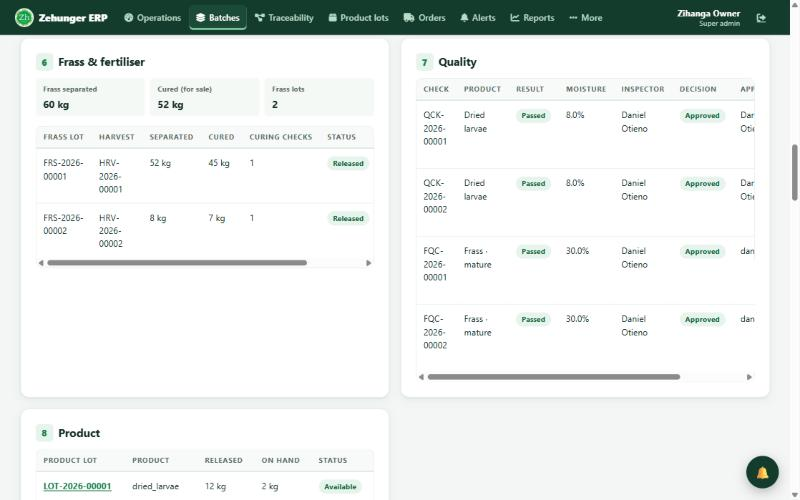

### 10.4 Reports

*Reports* → choose a report, period and farm → **Run report**. Every report exports to **CSV, Excel or PDF**.

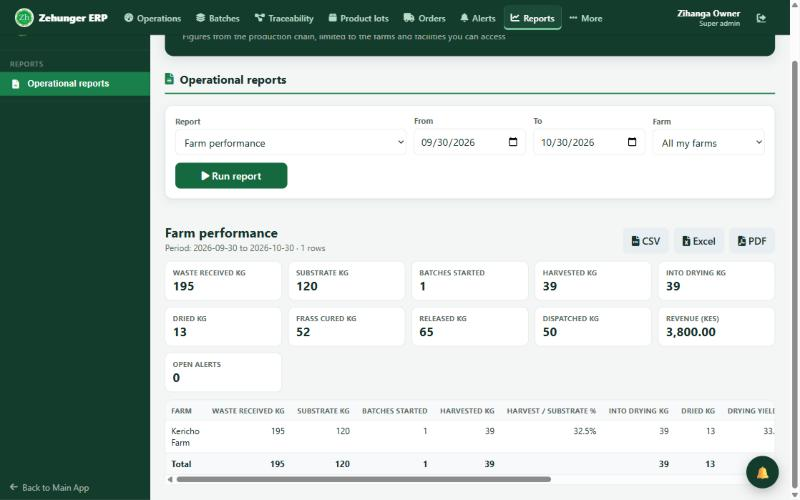

| Group | Reports |
|---|---|
| Production | Waste received, Substrate preparation, Production batches, Feeding activity, Harvest, Farm operation logs |
| Processing | Drying, **Frass & fertiliser**, Quality control |
| Stock & sales | Current stock, Customer orders, Deliveries |
| Traceability | Product lineage |
| Overview | Farm performance |

**Farm performance** for Kericho Farm: waste 195 kg, substrate 120 kg, harvested 39 kg (32.5% of substrate), dried 13 kg (33.3% drying yield), frass cured 52 kg, released 65 kg, dispatched 50 kg, revenue KES 3,800.

---

## Rules the system enforces

A summary for questions from the owners:

1. **Traceability is built in.** Every record links to its source; links are stored, never inferred.
2. **Quality gate.** No product reaches stock without a passed check and an approval; the database refuses it.
3. **Mass balance.** You cannot use more waste, substrate or harvest than exists, or harvest above a batch's limit.
4. **No future dates** on records.
5. **Location access.** People see only their farms, sites and facilities; sales and money need farm-level access.
6. **Roles.** Each action needs the right role: operators record work, QC officers decide quality, sales officers sell.
7. **Full audit trail.** Every change records who did it and when.
8. **Nothing is deleted once used.** Places and records are deactivated or reversed, so history stays complete.

---

## Suggested presentation script (about 25 minutes)

| Time | Step | Say this |
|---|---|---|
| 0–2 min | Introduction | "One batch, from market waste to a customer's shop, with every kilogram accounted for." |
| 2–4 | Step 0 and sign-in | Farm set-up and roles: each person sees only their own work. |
| 4–7 | Steps 1–2 | Waste in, quality gate (quarantine), substrate links back to waste. |
| 7–10 | Steps 3–5 | Production batch, daily records, harvest with frass as a second product. |
| 10–13 | Steps 6–7 | Drying at 3:1; frass cured into fertiliser. |
| 13–16 | Step 8 | QC: check, decide, release — the system blocks anything unapproved. |
| 16–20 | Step 9 | Customer, order with prices, reserve, dispatch, delivery and revenue. |
| 20–24 | Step 10 | Trace a delivery back to the market; dashboard; Batch 360; reports. |
| 24–25 | Close | What comes next (see below), questions. |

---

## Questions the audience may ask

**Can a farmer fake a harvest figure?** Every harvest is capped by the batch's harvest limit, linked to its batch and signed with the user and time. The audit trail shows any change.

**What if a product fails QC?** It is rejected with a reason and never reaches stock. A failed drying output can be re-checked while the batch waits for QC.

**Can we sell frass?** Yes. Frass is separated at harvest, cured, quality-checked and released as *frass fertiliser*, and it is ordered, delivered and traced exactly like dried larvae.

**How do we see profit?** Today the system records revenue (delivered kg × price). A full double-entry sales ledger with invoices, payments and customer balances is planned for the next phase.

**Does it work on a phone?** Yes. The Farmer Portal and all forms are designed for phones; operators record work in the field.

**Where is the data kept?** In a managed PostgreSQL database (Neon) that can be restored to an earlier point in time; the application runs on a hosted server (Render). Every working page requires sign-in.

---

## Reference numbers

| Prefix | Record |
|---|---|
| WL- | Waste lot |
| SUB- | Substrate batch |
| BSF- | Production batch |
| EVT- | Production event (feeding, monitoring, health, harvest) |
| HRV- | Harvest |
| FRS- | Frass lot |
| DRY- | Drying batch |
| QCK- | Quality check (dried larvae) |
| QCA- | Quality approval (dried larvae) |
| FQC- | Frass quality check |
| LOT- | Product lot (stock) |
| ORD- | Customer order |
| DEL- | Delivery |

---

## What comes next

- **Sales ledger:** invoices, payments (M-Pesa, bank, cash), customer balances and a double-entry ledger.
- **Waste collection page:** a redesigned waste intake screen (already built, held for after the presentation).
- **Cost tracking:** cost per kilogram, to report margins.
- **Hatchery and breeding links:** connecting egg and fly records to production batches.

---

*Zehunger Solutions — Circular Economy ERP. Phase One walkthrough guide, 30 October 2026.*
